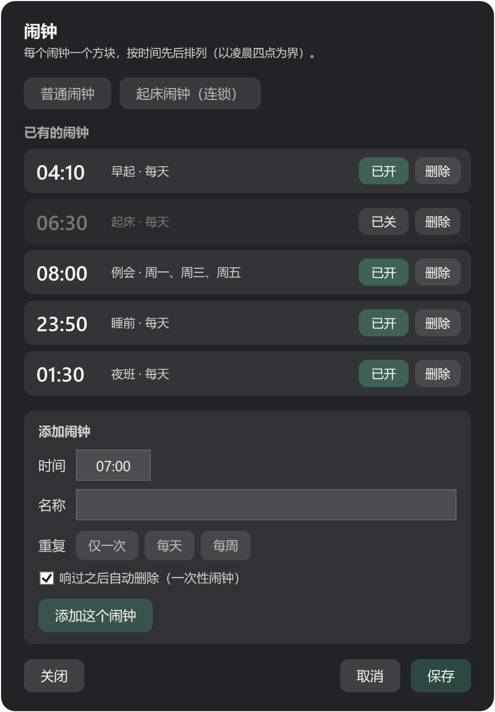
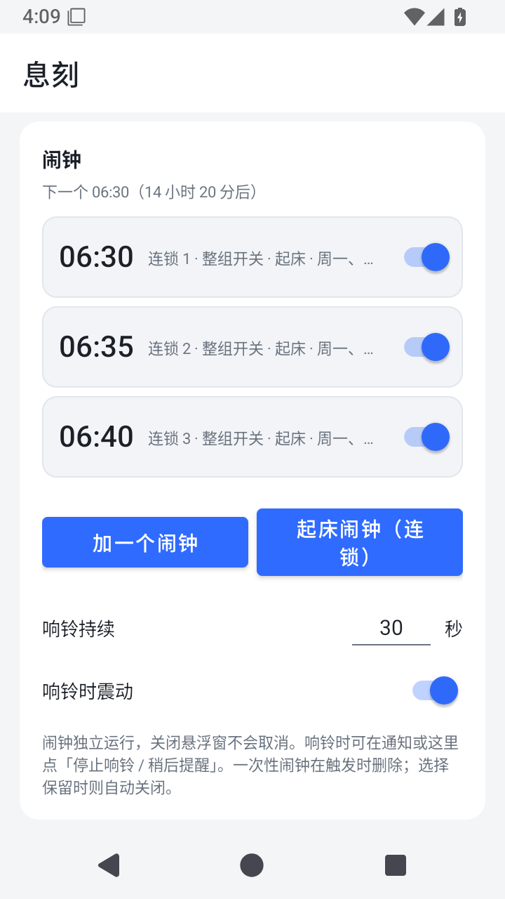
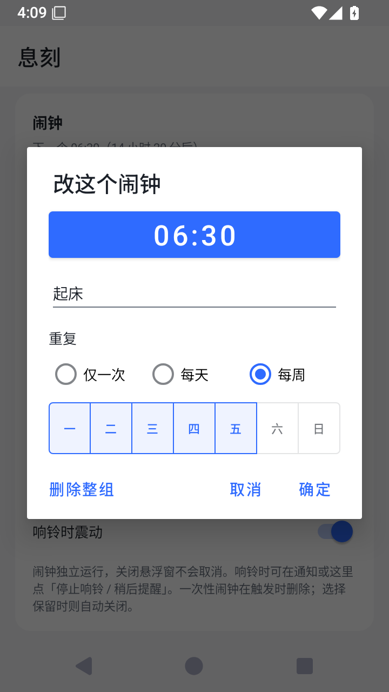

# 息刻（Xike）

Windows 桌面挂件与 Android 悬浮窗：早睡健康分、手动倒计时、普通闹钟与连锁起床闹钟。

## 项目入口

| 平台 | 源码与说明 | 版本 |
|---|---|---|
| Windows / WPF / .NET 8 | [desktop](desktop/README.md) | 2.0.3 |
| Android / Kotlin | [android](android/README.md) | 1.2.10 |

两个平台独立构建和发布，计分与闹钟规则通过各自测试保持一致。源码、测试和资源在本仓库，EXE 与 APK 通过 [GitHub Releases](https://github.com/h3y12/Xike/releases) 分发。

Windows 使用 .NET 8 SDK，在 `desktop/` 执行 `dotnet build -c Release`；安装包需要 .NET 8 Desktop Runtime。Android 使用 JDK 21、Android SDK 35，在 `android/` 执行 `gradlew.bat :app:assembleDebug :app:testDebugUnitTest`；Linux / macOS 使用 `./gradlew`。

## 界面预览

下图来自程序原生界面：Windows 使用隔离配置与固定示例时刻，Android 使用全新的 Android 15 模拟器和演示数据。

<table>
<tr><th>Windows 挂件</th><th>Android 首页</th><th>Android 悬浮窗</th></tr>
<tr>
<td></td>
<td></td>
<td></td>
</tr>
<tr><th>Windows 闹钟设置</th><th>Android 连锁列表</th><th>Android 整组编辑</th></tr>
<tr>
<td></td>
<td></td>
<td></td>
</tr>
</table>

[更多界面与采集说明](docs/SCREENSHOTS.md) · [公开准备与已知限制](docs/PUBLIC_READINESS.md) · [数据存储说明](docs/PRIVACY.md)

## 审查与整改

上传前完成了源码审查和 7 项整改，包括休眠后闹钟误响 / 漏响、旧草稿覆盖实时状态、Android 12+ 穿透透明度、声音回退、配置备份恢复、构建可移植性与测试退出码。详情见 [整改记录](docs/GITHUB_FIXES.md) 与 [初次审查报告](docs/GITHUB_PREP_REVIEW.md)。

当前仓库为私有仓库，双端 CI 会在每次 push / pull request 时检查构建与回归。真机跨应用穿透、整夜锁屏提醒、真实音频解码和混合 DPI 多屏仍需人工验收。正式开源许可证尚未选定。
