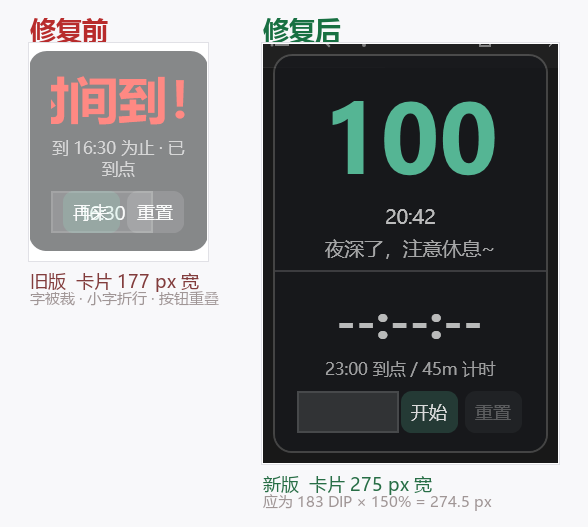

# 「远程控制时界面全乱」修复说明

2026-09-28

## 1. 你报的问题

> 我在本地电脑好像是 2K 分辨率，100% 缩放？当我远程控制这台电脑的时候，
> 分辨率是 2K，150% 缩放，这个 UI 就变成这样了。

截图里三件事同时发生：「时间到！」四个字左右各被切掉一角、
下面那行小字「到 16:30 为止 · 已到点」折成了两行、
底部输入框和「再来 / 重置」两个按钮叠在一起。



## 2. 怎么定位的：把截图当数据量

没有 4K 屏、也没法在你的远程会话里调试，所以先把截图当数据量出两个数：

| 量什么 | 实测 | 说明 |
|---|---|---|
| 红字「时间到！」的高度 | **47 px** | 33 DIP × 150% ≈ 49.5 → **内容是按 150% 画的** |
| 卡片宽度 | **177 px** | 183 DIP × 100% ≈ 183 → **窗口还是 100% 时的物理尺寸** |

两边一除：`177 ÷ 1.5 = 118` DIP。

也就是说 —— **WPF 把窗口当时那份物理宽度（177px）按新 DPI 反算了回去，写进了窗口的逻辑宽度**，
`Width` 从 183 掉到了 118。而 `118 × 1.5` 又正好等于 177，所以这个状态**自己看起来完全自洽，
再也不会长回来**。

内容于是按 118 DIP 的可用宽度排版：扣掉左右各 15 的内边距只剩 88 DIP，
而「时间到！」需要 115 DIP —— 溢出、折行、重叠，一次全出现。

## 3. 现场取证：你那个挂件当时确实是坏的

用系统 API 直接量正在运行的那个窗口（测量进程必须先声明成
`PER_MONITOR_AWARE_V2`，否则系统会给你"虚拟化"后的假尺寸）：

```
PID=21244  标题='TimeGuard'  会话=RDP-Tcp#11
    整窗 = 183 x 429 px    窗口DPI=144 (150%)
    183 DIP 应为 274.5 px → 现在 183 px   ✗ 漂了（差 -91 px）
```

183px 与截图量到的 177px 是同一回事（差 6px 来自圆角与半透明边缘）。
**同一台机器上的独立证据，不是推测。**

## 4. 根因

`SizeToContent="Height"` + `WindowStyle=None` + `AllowsTransparency=True` 这个组合下，
**WPF 会把窗口 client 的物理宽度按当前 DPI 反算回来、写进 `Width` 属性**。

平时无害 —— 稳定状态下本机（150%）的窗口宽度就是 `183.33 DIP`（= 275px ÷ 1.5）。
但在 **DPI 切换的那一瞬间**，窗口的物理尺寸还没更新（还是旧 DPI 的 183px），
WPF 却已经用新 DPI（1.5）去反算 → `183 ÷ 1.5 = 122`，宽度就这么"缩"了。

**这条的独立佐证**：把宽度故意打成 118 DIP、让守护纠回来之后，
量到的稳定值是 **183.33**（不是整数 183）—— 正好等于 `275 ÷ 1.5`，
说明"反算回写"这件事确实存在。

## 5. 改了什么

| 改动 | 位置 |
|---|---|
| **宽度只有一个来源**：新增 `MainWindow.CardWidth = 183`，XAML 用 `{x:Static}` 指过来；`Snapshot.cs`、`SelfTest.cs` 里各写一份的 `183` 一并收归 | `MainWindow.xaml(.cs)`、`Snapshot.cs`、`SelfTest.cs` |
| **`EnsureWindowSize()` 每帧核对尺寸**：① 逻辑宽度漂了就钉回常量；② 物理宽度不对就用 `SetWindowPos` 补一刀。挂在 `Refresh()` 最前面 | `MainWindow.xaml.cs` |
| **`OnDpiChanged` 重写**：删掉原来那段「切 `SizeToContent` → 失效测量 → 切回来」（那正是这个 bug 的来源），换成"先钉尺寸、再重排、再夹位置，700ms 后复查一次" | `MainWindow.xaml.cs` |
| **算高度改用常量宽度**（原来读 `Width` 属性）：万一宽度正在漂，高度不能跟着一起错 | `MainWindow.xaml.cs` |
| **新增 `WindowPlacement.ExpectedPhysicalWidth`**：算出「某个逻辑宽度在某个缩放下应该是多少像素」，运行期与自检共用一份 | `WindowPlacement.cs` |
| **新增「宽度与 DPI」自检段（8 条）+ `--uicheck` 两条实测** | `SelfTest.cs`、`App.xaml.cs` |
| 出问题时往 `%TEMP%\TimeGuard-dpi.log` 记一行现场（正常时不产生这个文件） | `MainWindow.xaml.cs` |

关于容差：守护的容差取 **1 DIP** 而不是 0.5 —— 因为正常状态下 `Width` 本来就是 `183.33`
这种带小数的值（WPF 反算回写的结果），容差太小会每帧误判、每帧调一次 Win32，反而抖。
真正的漂移是 65 DIP（183 → 118）这个量级，1 DIP 的容差不会漏。

## 6. 验证

| | 结果 |
|---|---|
| 电脑版自检（`--selftest`） | **245 通过 / 0 失败**（237 基线 → 新增 8 条） |
| 新增的「宽度与 DPI」段 | 100% → 183px ／ 125% → 229px ／ **150% → 275px** ／ 175% → 320px ／ 200% → 366px，全 PASS |
| `--uicheck` 第 12 条（守护自愈，实测） | 把宽度打成 118 DIP → 700ms 后回到 **183.33**，**PASS** |
| `--uicheck` 第 13 条（物理宽度，实测） | 本机 dpi=1.5（150%），**实测 275px = 应为 275px**，**PASS** |
| 编译 / 发布 | 0 警告 0 错误 |

自检顺手抓出一个真问题：`Math.Round` 默认是**银行家舍入**，
`183 × 1.5 = 274.5` 会被算成 **274**，而 Windows 的 DPI 换算是四舍五入 → **275**。
已改成显式 `MidpointRounding.AwayFromZero`。

> 说明：这台机器**当前就是 150% 缩放**（`GetDpiForSystem` = 144），
> 所以上面两条实测就是在出问题的那个缩放下跑的，不是"在 100% 下推出来的"。

## 7. 需要你做的一步

`dist\TimeGuard.exe` 已换成新版，但你正在跑的那个进程还是旧版（它此刻就是坏的）：

```
右键挂件（或托盘图标）→ 退出，再双击桌面图标
```

然后**断开远程、再连一次**（或反过来）—— 这一步会真正触发 DPI 切换，
是唯一能验证"跨缩放"的地方。

旧版已备份成 `dist\TimeGuard.exe.old-20260928`，确认新版没问题后可以删。

## 8. 如果还坏

把 `%TEMP%\TimeGuard-dpi.log` 发我（`%TEMP%` 在资源管理器地址栏输入 `%TEMP%` 回车）。
里面会记下每次 DPI 变化和每次宽度纠正的现场数字 ——
**有它就不用再从截图反推了**。

## 9. 未改动的部分（说明一下）

三个子窗口（设置窗 / 闹钟设置窗 / 响铃弹窗）结构与主窗口相同，
但它们是**每次打开新建**的 —— 不存在"从旧 DPI 切过来"的过程，所以不受影响。
只有常驻的挂件会经历 DPI 变化。如果你在这三个窗口上也看到过同样的裁字，告诉我，一并处理。
