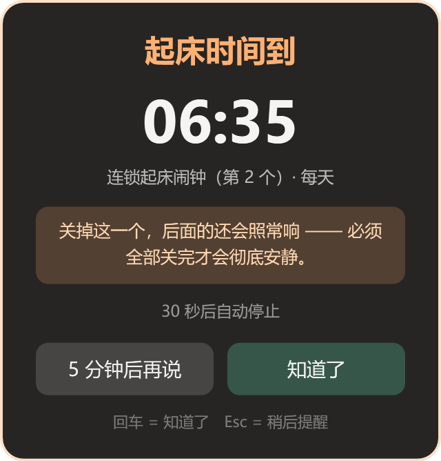
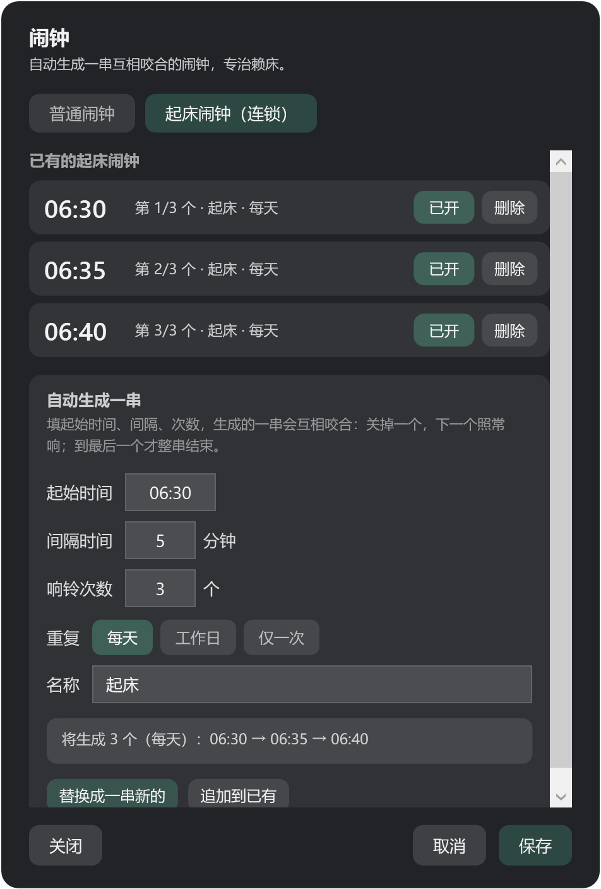
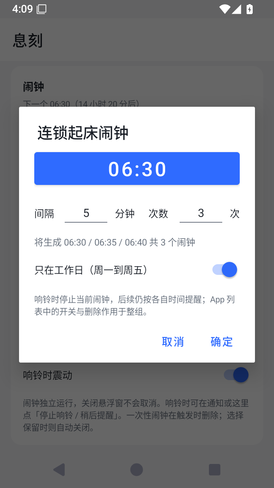

# 双端界面效果图

Windows 图片直接渲染实际 WPF 控件；Android 图片通过 adb 采集实际运行的 Android 15 模拟器界面。没有使用 AI 重画 UI。全部使用隔离的示例配置，没有截取个人桌面或真实手机数据。

截图时为让悬浮窗可见，模拟器的演示“出现时间”设为 00:00；应用默认时间仍是 20:30。健康分、倒计时与闹钟均由真实逻辑生成。截图展示界面，不代表真实手机整夜提醒已经验收。

## Windows

| 挂件 | 响铃窗口 |
|---|---|
|  |  |

| 普通闹钟设置 | 连锁起床闹钟设置 |
|---|---|
|  |  |

[完整阶段快照](images/desktop-overview.png) · [规则设置](images/desktop-settings.png)

在 Windows 构建后运行 `TimeGuard.exe --snapshot <输出目录>/desktop-overview.png`，可生成概览和各个独立窗口快照。该模式使用隔离配置，不读取个人闹钟。

## Android

| 首页 | 跨应用悬浮窗 | 连锁闹钟列表 |
|---|---|---|
|  |  |  |

| 创建连锁 | 编辑与整组删除 |
|---|---|
|  |  |

采集使用空白模拟器、debug APK 与 adb screencap，等待切换动画和提示消息结束后保存。连锁示例为 06:30 / 06:35 / 06:40，间隔 5 分钟，共 3 次。